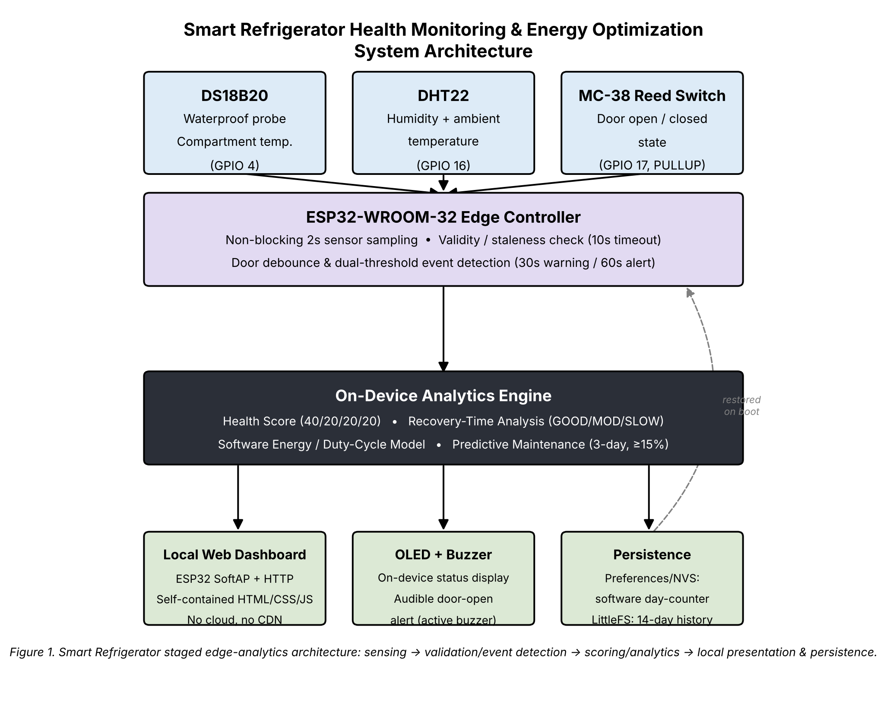
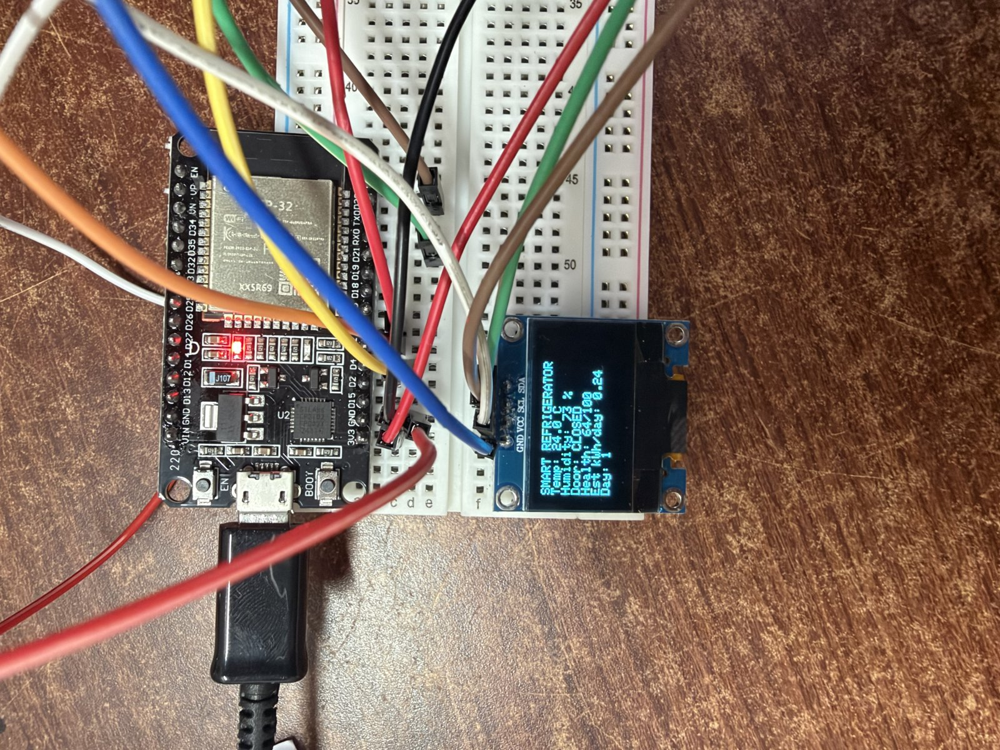
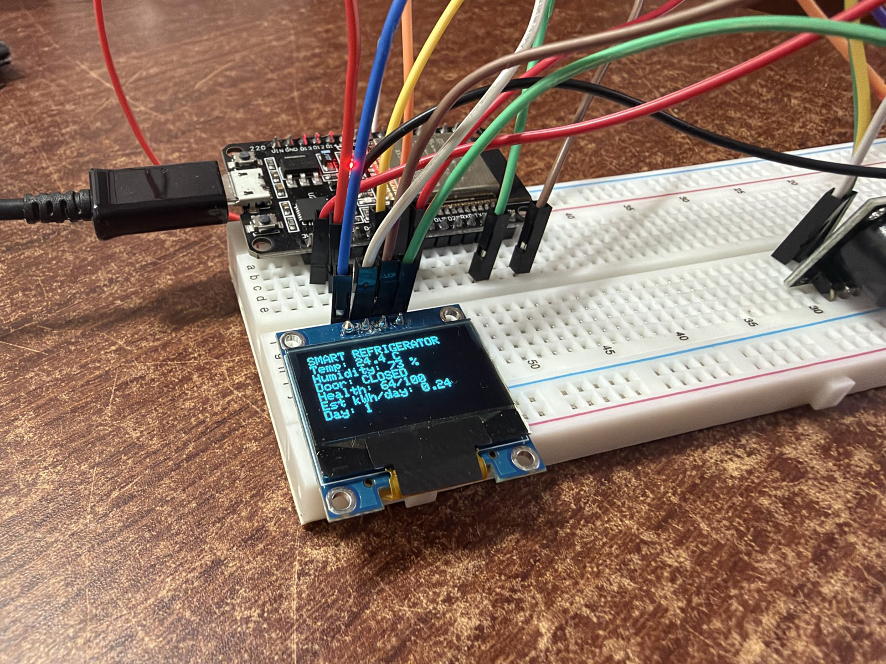
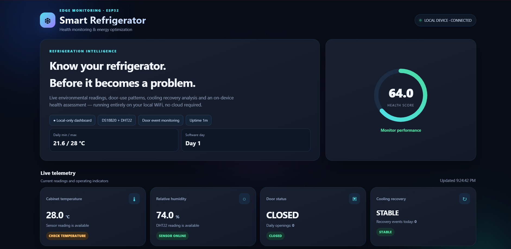
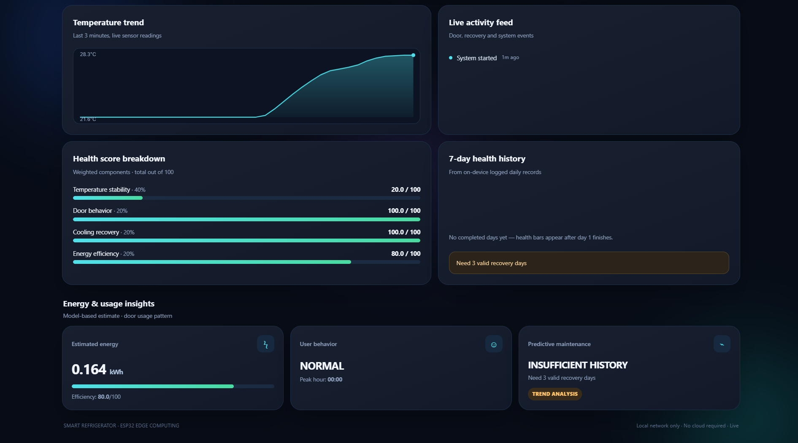

# Smart Refrigerator Health Monitoring & Energy Optimization (ESP32)

An offline, single-chip ESP32 system that monitors a refrigerator's temperature, humidity and door behaviour, and turns them into a 0–100 health score, a software energy estimate and a predictive-maintenance flag. It serves its own dashboard over a WiFi access point, with no cloud, app or internet needed.

Embedded Systems project, VIT Vellore. Team: Kevin Joseph (25BCE2971), Alina Paleri (25BCE0411), Shasmeen Alesha (25BCE2928).



## Features
- Non-blocking DS18B20 / DHT22 sampling with validity and staleness checks (10 s)
- Door intelligence: 30 s buzzer warning, 60 s alert state, openings per hour
- Cooling-recovery timing, graded GOOD / MODERATE / SLOW
- Health score = 40% temperature + 20% door + 20% recovery + 20% energy
- Model-based energy estimate (kWh/day). It is an estimate, not a measurement
- Predictive maintenance: recovery time strictly rising over 3 valid days by at least 15%
- Software day counter (Preferences/NVS) and 14-day history (LittleFS), with no RTC
- Self-contained dashboard (SoftAP + HTTP, no CDN) and OLED status screen

## Hardware
| Component | Connection |
|---|---|
| ESP32-WROOM-32 | controller |
| DS18B20 waterproof probe | GPIO 4 (4.7 kΩ pull-up) |
| DHT22 | GPIO 16 |
| MC-38 reed switch | GPIO 17 (INPUT_PULLUP) |
| SSD1306 0.96" OLED (I²C) | SDA 21, SCL 22 |
| Active buzzer | GPIO 25 |

<p>


</p>

## Build and run
1. Install Arduino IDE with the ESP32 board package. Libraries: OneWire, DallasTemperature, DHT sensor library, Adafruit SSD1306, Adafruit GFX.
2. Open `firmware/smart_refrigerator/smart_refrigerator.ino`, select **ESP32 Dev Module**, and upload.
3. Connect to the WiFi network `Smart_Refrigerator` (default password in the firmware; change `AP_PASSWORD` before sharing) and open the dashboard IP printed on the serial monitor (the ESP32 default is `192.168.4.1`).

Build result: 978,860 bytes (74% flash), 47,504 bytes (14% RAM).

## Dashboard



## Status
TRL 4, validated on the bench. Multi-day in-refrigerator validation is still pending.

## Documentation
`docs/` contains the VIT IDF-B invention disclosure, the prior-art differentiation analysis, a technical explainer / viva prep, and the project presentation.

## Repository layout
```
firmware/smart_refrigerator/   final firmware
firmware/archive/              earlier prototype
docs/                          IDF-B, novelty analysis, viva prep, slides
images/                        hardware photos, dashboard screenshots, diagrams
```
